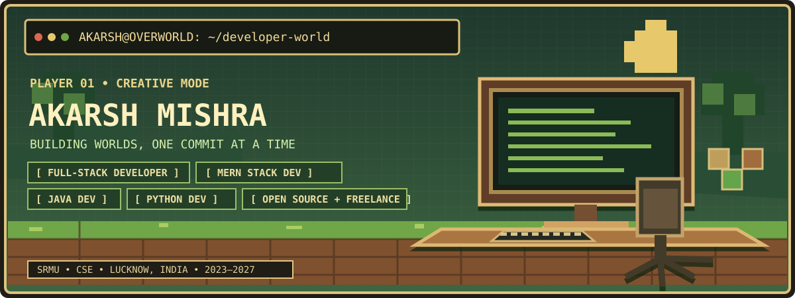
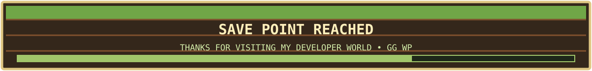

---

## 🟩 PLAYER INVENTORY

<table>
<tr>
<td align="center" width="33%">
 <b>CLASS</b> Full-Stack Builder
</td>
<td align="center" width="33%">
 <b>GUILD</b> Open Source
</td>
<td align="center" width="33%">
 <b>SECONDARY SKILL</b> AI / ML Explorer
</td>
</tr>
<tr>
<td align="center"> Java Developer</td>
<td align="center"> MERN Stack</td>
<td align="center"> Freelance / Ship</td>
</tr>
</table>

## 🧍 ABOUT THIS PLAYER

> **PLAYER NAME:** Akarsh Mishra  
> **SPAWN POINT:** Lucknow, India  
> **EDUCATION:** B.Tech Computer Science & Engineering · Shri Ramswaroop Memorial University (SRMU), 2023–2027  
> **CURRENT QUEST:** Turn useful ideas into polished web products; explore AI, machine learning and computer vision.

I build full-stack web applications and prototypes with a product mindset: understand the problem, ship a useful version, test it, and improve it. I work with the MERN ecosystem, Java and Python, and explore AI-assisted products and computer-vision research.

## 🪓 WORLD SELECT — PROJECTS

<table>
<tr>
<td width="50%" valign="top">

### 🟩 ENROLE
**AI-assisted interview platform**

A recruitment and interview-practice product concept designed to make preparation more structured.

</td>
<td width="50%" valign="top">

### 🧪 MedRx
**Medical report interpreter**

An AI-assisted interface exploring how medical reports can be explained in more accessible language.

</td>
</tr>
<tr>
<td width="50%" valign="top">

### 🌦️ WeatherGPT
**Weather + AI experience**

A project focused on presenting weather information with a more conversational experience.

</td>
<td width="50%" valign="top">

### 🧠 Cognitive Load Detector
**Cognitive fatigue exploration**

An exploratory, privacy-aware project around cognitive load signals and fatigue analysis.

</td>
</tr>
<tr>
<td width="50%" valign="top">

### 💎 Mahakal Swarn Builder
**Local business website**

A web experience built to present a jewellery business and its services.

</td>
<td width="50%" valign="top">

### 🧰 More builds
**The rest of the inventory**

Browse games, experiments, tools and other prototypes in the repository chest.

</td>
</tr>
</table>

## ⛏️ SKILL TREE — LANGUAGES, TOOLS & FRAMEWORKS

**LANGUAGES**

**FRONTEND & BACKEND**

**DATABASES, AI & ML**

**WORKBENCH**

## 🎒 XP & LEVEL REPORT

**LEVEL 12 → LEVEL 13**

`███████████████░░░░░`  **750 / 1,000 XP**

<table>
<tr><th>Quest completed</th><th>XP reward</th><th>Evidence / progress</th></tr>
<tr><td>Ship projects and prototypes</td><td>+150 XP</td><td><a href="https://github.com/Code-AkarshMishra?tab=repositories">Project inventory</a></td></tr>
<tr><td>Research & experiment</td><td>+100 XP</td><td><a href="https://github.com/Code-AkarshMishra">Public profile</a></td></tr>
<tr><td>Hackathon participation</td><td>+100 XP</td><td>HackWithUP’25 / SIH internal round</td></tr>
<tr><td>Write, document, share</td><td>+50 XP</td><td><a href="https://dev.to/codeakarshmishmra">DEV profile</a></td></tr>
</table>

XP and level are a self-managed RPG metaphor, not an official GitHub score. Update the level, bar and rewards yourself as you complete milestones.

## 🏅 TROPHY ROOM — ACHIEVEMENTS & REPORT CARD

<table>
<tr>
<td align="center" width="50%">
<a href="https://github.com/Code-AkarshMishra?tab=achievements">
 
<b>GITHUB ACHIEVEMENTS</b>
</a> 
Open original achievement page
</td>
<td align="center" width="50%">
<a href="https://github.com/Code-AkarshMishra?tab=achievements">
 
<b>ACHIEVEMENT CASE</b>
</a> 
See badges actually unlocked on GitHub
</td>
</tr>
</table>

| Grade | Milestone | Detail |
|:--:|---|---|
| **S** | SIH 2026 internal round | First rank with Team One Percent, based on details shared for the project |
| **A** | HackWithUP’25 | Finalist / Grand Finale competitor |
| **A** | Research | Presented lightweight CNN facial-emotion recognition for sustainable Edge AI at ICSI 2.0, SRMU |
| **A** | Builder | Developing full-stack projects and AI/ML prototypes |

## 📜 LIVE REPORT CARD — STREAK & STATS

Streak, repository statistics and language cards are live third-party images. They can temporarily rate-limit or go offline. GitHub's official profile page remains the source of truth for contribution counts.

## 🐍 CONTRIBUTION GARDEN

<picture>
  <source media="(prefers-color-scheme: dark)" srcset="https://raw.githubusercontent.com/Code-AkarshMishra/Code-AkarshMishra/output/github-snake-dark.svg">
  <source media="(prefers-color-scheme: light)" srcset="https://raw.githubusercontent.com/Code-AkarshMishra/Code-AkarshMishra/output/github-snake.svg">
  
</picture>

## 🗺️ WORLD MAP & 3D SKYLINE

The map and 3D skyline are optional generated assets. Enable their upstream workflows to publish these files before expecting them to render.

## 🎮 ARCADE — ENTER A MINI-GAME

GitHub README cannot execute embedded JavaScript, so the game badges open the Readme Games project where the playable mini-games and setup are hosted.

## 📡 CONNECT WITH THE PLAYER

