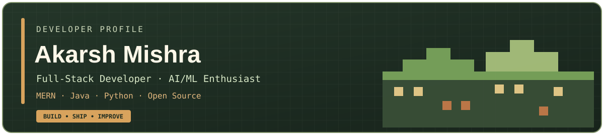
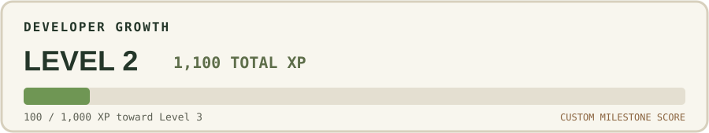

## About

I’m a B.Tech Computer Science student at **Shri Ramswaroop Memorial University (SRMU)**, focused on full-stack development, product engineering, and applied AI/ML. I build web applications from UI to API and database, and explore computer vision through research and prototypes.

**Currently interested in:** Full-Stack / MERN Development · Software Engineering · AI-powered products · Open Source

## Featured Projects

<table>
<tr>
<td width="50%" valign="top">

### ENROLE
AI-assisted interview and recruitment platform.

</td>
<td width="50%" valign="top">

### MedRx
Medical-report interpretation project focused on making report information easier to understand.

</td>
</tr>
<tr>
<td width="50%" valign="top">

### WeatherGPT
Weather-focused project exploring conversational access to weather information.

</td>
<td width="50%" valign="top">

### Cognitive Load Detector
Privacy-focused prototype for exploring fatigue and cognitive-load signals.

</td>
</tr>
<tr>
<td width="50%" valign="top">

### Mahakal Swarn Builder
Business website and customer-facing service experience.

</td>
<td width="50%" valign="top">

### Sparsh Trading
Trading-related web project.

</td>
</tr>
</table>

## Technologies & Tools

## Achievements & Milestones

<table>
<tr><td width="35%"><b>Smart India Hackathon 2026</b></td><td>First rank in the internal hackathon with Team One Percent.</td></tr>
<tr><td><b>HackWithUP 2025</b></td><td>Finalist / Grand Finale competitor.</td></tr>
<tr><td><b>Research</b></td><td>Presented research on lightweight CNN-based facial emotion recognition for sustainable Edge AI at ICSI 2.0, SRMU.</td></tr>
<tr><td><b>Technical community</b></td><td>Technical club documentation and event coordination.</td></tr>
</table>

## Developer Growth Level

The profile's custom XP score is calculated from documented milestones; it is a profile-design metric, **not an official GitHub rank or academic grade**.

<b>How the level is calculated</b>

| Milestone | Rule | XP |
|:--|:--|--:|
| MedRx live deployment | 1 × 150 XP | 150 |
| Mahakal Swarn Builder live deployment | 1 × 150 XP | 150 |
| Sparsh Trading live deployment | 1 × 150 XP | 150 |
| SIH 2026 internal first rank | milestone | 300 |
| HackWithUP 2025 finalist | milestone | 150 |
| ICSI 2.0 research presentation | milestone | 200 |
| **Total** | | **1,100 XP** |

**Formula:** `Level = floor(Total XP / 1,000) + 1`.

At 1,100 XP, the profile is at **Level 2**, with **100 / 1,000 XP** toward Level 3. Keep these custom XP values updated as milestones change.

## GitHub Statistics

## Coding Profiles

