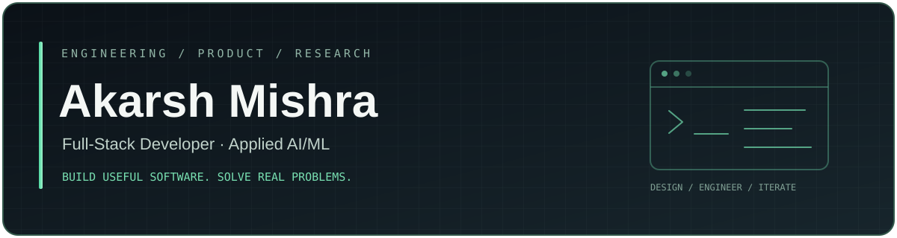
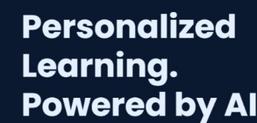
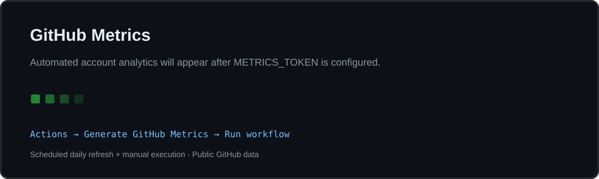

# Akarsh Mishra | Software Engineer, Full-Stack Developer & AI/ML

**Akarsh Mishra** is a Computer Science and Engineering undergraduate at **Shri Ramswaroop Memorial University (SRMU), India**. I build full-stack web applications with **JavaScript, TypeScript, React, Next.js, Node.js, Express and MongoDB**, and explore **applied AI/ML, computer vision and Edge AI** using Python and deep-learning frameworks.

<div align="center">



<table>
<tr>
<td width="27%" align="center" valign="middle">

</td>
<td width="73%" valign="middle">

### Full-Stack Development · Applied AI/ML · Computer Vision

B.Tech CSE (2023–2027) at SRMU. Interested in software engineering, scalable web products, backend systems, intelligent applications, and research-driven engineering.

<a href="https://code-akarshmishra.vercel.app"></a>
<a href="https://www.linkedin.com/in/code-akarshmishra/"></a>
<a href="mailto:akarshmishmra3145@gmail.com"></a>
<a href="https://github.com/Code-AkarshMishra?tab=repositories"></a>

</td>
</tr>
</table>


*Build thoughtfully. Ship consistently. Keep learning.*

</div>

---

## Engineering Profile

I work across frontend, backend, APIs, databases, deployment, and applied machine learning. My approach is product-oriented: understand the user problem, design a maintainable solution, verify the important paths, and improve from feedback.

| Area | Current focus |
|---|---|
| **Software engineering** | Full-stack web development, REST API design, application architecture |
| **Frontend** | React, Next.js, JavaScript, TypeScript, responsive interfaces |
| **Backend** | Node.js, Express.js, API integration, authentication and server-side logic |
| **Databases** | MongoDB, MySQL, PostgreSQL |
| **Artificial intelligence** | Applied machine learning, deep learning, computer vision |
| **Research** | Lightweight CNNs, facial emotion recognition, Edge AI |
| **Developer workflow** | Git, GitHub, code review, testing, documentation and deployment |

## Featured Software Projects

These projects represent my work in full-stack development, AI-powered applications, computer vision, and business-focused web engineering.

<table>
<tr>
<td width="50%" valign="top">

### ENROLE — Smart Interview Platform

An AI-assisted recruitment and interview platform focused on candidate workflows, interview management, evaluation, and hiring analytics.

<a href="https://github.com/Code-AkarshMishra/ENROLE"></a>

</td>
<td width="50%" valign="top">

### MedRx — AI Medical Report Interpreter

An AI-powered application designed to make medical report information easier to understand through patient-friendly explanations.

<a href="https://github.com/Code-AkarshMishra/MedRx"></a>
[Live project ↗](https://medrx-beta.vercel.app)

</td>
</tr>
<tr>
<td width="50%" valign="top">

### NeuroTrack AI — Cognitive Load Detector

A multimodal cognitive-load and mental-fatigue analysis prototype exploring interaction signals and privacy-conscious session insights.

<a href="https://github.com/Code-AkarshMishra/CognitiveLoadDetector"></a>

</td>
<td width="50%" valign="top">

### FrameSutra — Video Intelligence Platform

A local-first video intelligence project combining transcription, summarisation, visual analysis, and retrieval-augmented question answering.

<a href="https://github.com/Code-AkarshMishra/FrameSutra"></a>

</td>
</tr>
<tr>
<td width="50%" valign="top">

### WeatherGPT — Conversational Weather

A conversational weather project developed for the Smart India Hackathon 2026 internal selection process.

<a href="https://github.com/Code-AkarshMishra/WeatherGPT"></a>

</td>
<td width="50%" valign="top">

### Mahakal Swarn Builder

A business-facing website designed to present services and create a clear customer experience.

<a href="https://github.com/Code-AkarshMishra/mahakalswarnbuilder"></a>
[Live project ↗](https://mahakalswarnbuilder.vercel.app)

</td>
</tr>
</table>

### More work

- **Sparsh Trading:** Trading-related web project — [repository](https://github.com/Code-AkarshMishra/Sparsh-Trading) · [live website](https://sparshtrading.shop)
- **Prepbot.ai:** AI-assisted educational product prototype — [repository](https://github.com/Code-AkarshMishra/Prepbot.ai)

[Explore all GitHub repositories →](https://github.com/Code-AkarshMishra?tab=repositories)

## Project Screenshots & Demonstrations

Screenshots below are served from my existing portfolio repository. Project GIFs and event photographs can be added to `assets/projects/`, `assets/demos/`, and `assets/photos/` as they become available.

<div align="center">
<table>
<tr>
<td width="33%" align="center" valign="top">

**ENROLE**

<a href="https://github.com/Code-AkarshMishra/ENROLE">

</a>

</td>
<td width="33%" align="center" valign="top">

**MedRx**

<a href="https://github.com/Code-AkarshMishra/MedRx">

</a>

</td>
<td width="33%" align="center" valign="top">

**Prepbot.ai**

<a href="https://github.com/Code-AkarshMishra/Prepbot.ai">

</a>

</td>
</tr>
</table>
</div>

## Technical Skills & Technology Stack

<div align="center">

</div>

| Category | Technologies |
|---|---|
| **Programming languages** | JavaScript, TypeScript, Python, Java, C++, SQL |
| **Frontend development** | React.js, Next.js, HTML5, CSS3, Tailwind CSS |
| **Backend development** | Node.js, Express.js, REST APIs |
| **Databases** | MongoDB, MySQL, PostgreSQL |
| **AI and machine learning** | TensorFlow, Keras, PyTorch, OpenCV |
| **Tools and platforms** | Git, GitHub, Postman, VS Code, Vercel |

## Research, Hackathons & Achievements

- **ICSI 2.0 — Research Presentation, SRMU:** Presented *“Lightweight CNN-based Facial Emotion Recognition to attain sustainable Edge AI systems”*, focused on compact convolutional neural networks for edge-oriented facial emotion recognition.
- **Smart India Hackathon 2026 — SRMU Internal Round:** Secured **first rank** with **Team One Percent** in the university's internal hackathon.
- **HackWithUP 2025:** Reached the finalist / grand-finale stage.
- **Open-source programmes:** Selected for GSSoC and SSOC community programmes.

[View official GitHub achievements ↗](https://github.com/Code-AkarshMishra?tab=achievements)

## Leadership & Technical Community

- **General Secretary, Tech Fusion Club (SRMU):** Supporting technical-community initiatives, coordination, and student engagement.
- **Former Documentation Lead:** Managed technical documentation and event-related coordination.
- I value ownership, clear communication, teamwork, documentation, and maintainable software engineering practices.

## GitHub Statistics & Live Activity

The following cards query public GitHub data through external services. Those services apply caching, so the images are API-backed but are not guaranteed to refresh immediately after each GitHub event.

<div align="center">
<a href="https://github.com/anuraghazra/github-readme-stats">

</a>
<a href="https://github.com/anuraghazra/github-readme-stats">

</a>
</div>

<div align="center">
<a href="https://github.com/denvercoder1/github-readme-streak-stats">

</a>
</div>

### GitHub Contribution Activity

<div align="center">
<a href="https://github.com/ashutosh00710/github-readme-activity-graph">

</a>
</div>

### Animated Contribution Snake

<div align="center">
<picture>
  <source media="(prefers-color-scheme: dark)" srcset="https://raw.githubusercontent.com/Code-AkarshMishra/Code-AkarshMishra/output/github-snake-dark.svg"/>
  <source media="(prefers-color-scheme: light)" srcset="https://raw.githubusercontent.com/Code-AkarshMishra/Code-AkarshMishra/output/github-snake.svg"/>
  
</picture>
</div>

### GitHub Achievements & Extended Metrics

<div align="center">
<a href="https://github-profile-trophy.vercel.app/">

</a>
</div>



[Open official GitHub achievements page ↗](https://github.com/Code-AkarshMishra?tab=achievements)

### Update frequency and data sources

| Profile element | Source | Refresh behaviour |
|---|---|---|
| Repository statistics and language cards | GitHub Readme Stats | API-backed; provider cache applies |
| Contribution streak | Streak Stats | API-backed; provider cache applies |
| Contribution activity graph | Activity Graph | API-backed; provider cache applies |
| Achievement trophy display | Profile Trophy | API-backed; provider cache applies |
| Contribution snake | GitHub contribution calendar | GitHub Actions daily + manual run |
| Extended metrics and achievements | Lowlighter Metrics | GitHub Actions daily + manual run |

**Accuracy note:** GitHub profile READMEs are static Markdown. They cannot run custom browser-side JavaScript or guarantee second-by-second API refresh. This setup uses live/cached external API image endpoints plus scheduled GitHub Actions for generated assets.

## Engineering Workflow

```text
DISCOVER
  Understand the user problem and constraints
       ↓
DESIGN
  Define scope, user flow, architecture and data model
       ↓
BUILD
  Implement frontend, backend, APIs and integrations
       ↓
VERIFY
  Test behaviour, review edge cases and fix defects
       ↓
SHIP
  Deploy, document, monitor and iterate
```

**Engineering principles:** readable code · clear interfaces · secure defaults · useful documentation · measurable outcomes.

## Let's Connect

<div align="center">

<a href="https://code-akarshmishra.vercel.app">Portfolio</a> ·
<a href="https://www.linkedin.com/in/code-akarshmishra/">LinkedIn</a> ·
<a href="https://leetcode.com/u/code_akarshmishra/">LeetCode</a> ·
<a href="https://www.hackerrank.com/CodeAkarshMishra">HackerRank</a> ·
<a href="https://dev.to/codeakarshmishra">DEV Community</a> ·
<a href="mailto:akarshmishmra3145@gmail.com">Email</a>


<sub>Thanks for visiting. Explore the repositories, inspect the implementations, and connect about engineering opportunities or technical collaboration.</sub>

</div>
