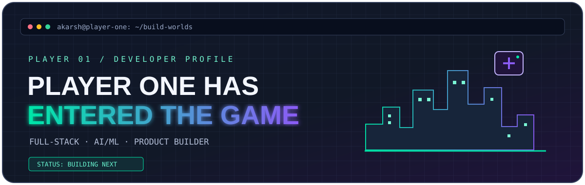

**FULL-STACK DEVELOPER · AI/ML EXPLORER · PRODUCT BUILDER**

`Lucknow, India` · `B.Tech CSE @ SRMU` · `2023–2027`

---

## 🕹️ PLAYER HUD

<table>
<tr>
<td width="58%" valign="top">

### `PLAYER 01` — Akarsh Mishra

I build useful digital products at the intersection of **web engineering, AI, and product thinking**. I enjoy taking an idea from a rough sketch to a working prototype, then iterating based on what users actually need.

- **Main quest:** ship practical, polished products
- **Current worlds:** full-stack development, AI-assisted workflows, computer vision
- **Build style:** user-first, iterative, performance-conscious
- **Looking for:** product engineering, software engineering, and AI-focused opportunities

</td>
<td width="42%" valign="top">

### 🎮 CHARACTER BUILD

| Attribute | Loadout |
|:--|:--|
| Class | Full-stack builder |
| Specialty | React · Next.js · Node.js |
| Research tree | ML · Computer Vision |
| Mindset | Product + execution |
| Current mission | Build, learn, ship |

</td>
</tr>
</table>

## ⚔️ RPG LEVEL & XP

> **Level system is a personal gamification metaphor**, not an official GitHub score. Adjust XP as you complete meaningful milestones.

**CURRENT LEVEL — 12 · Product Crafter**

`███████████████░░░░░` **750 / 1,000 XP** to Level 13

| Quest | XP reward | Status |
|:--|--:|:--|
| Ship a working project MVP | +150 XP | Repeatable |
| Merge a meaningful open-source contribution | +100 XP | Repeatable |
| Publish a technical write-up or research result | +100 XP | Repeatable |
| Complete a focused learning milestone | +50 XP | Repeatable |
| Demo a project and document user feedback | +100 XP | Repeatable |

<b>XP rules & level progression</b>

- Level 1 starts at 0 XP.
- Every 1,000 XP advances one level.
- Award XP for shipped work and verifiable milestones, not just time spent.
- Update the meter manually when you want your profile to reflect your progress.
- Suggested title progression: `Novice Builder` → `Code Adventurer` → `Product Crafter` → `Systems Architect` → `AI Pathfinder`.

---

## 🧭 SELECT YOUR QUEST

<table>
<tr>
<td width="50%" valign="top">

### 🧠 ENROLE
**AI-assisted interview platform**

A recruitment workflow concept focused on helping candidates practise interviews and make preparation more structured.

[Repository ↗](https://github.com/Code-AkarshMishra/ENROLE)

</td>
<td width="50%" valign="top">

### 🩺 MedRx
**Medical report interpreter**

Exploring ways to make medical-report language easier to understand with an AI-assisted interface.

[Repository ↗](https://github.com/Code-AkarshMishra/MedRx) · [Live demo ↗](https://medrx-beta.vercel.app)

</td>
</tr>
<tr>
<td width="50%" valign="top">

### 🌦️ WeatherGPT
**Weather information + AI**

A weather-focused project exploring more natural ways to understand weather context.

[Repository ↗](https://github.com/Code-AkarshMishra/WeatherGPT)

</td>
<td width="50%" valign="top">

### 🧪 NeuroTrackAI
**Cognitive load & fatigue analysis**

A privacy-aware exploration of signals and interactions for estimating cognitive fatigue.

[Repository ↗](https://github.com/Code-AkarshMishra/CognitiveLoadDetector)

</td>
</tr>
<tr>
<td width="50%" valign="top">

### 🪙 Mahakal Swarn Builder
**Business website experience**

A product-oriented website focused on presenting a local business and its services.

[Repository ↗](https://github.com/Code-AkarshMishra/mahakalswarnbuilder) · [Live demo ↗](https://mahakalswarnbuilder.vercel.app)

</td>
<td width="50%" valign="top">

### 🧩 More experiments
**Games, utilities & prototypes**

Small builds are where new mechanics, ideas, and implementation patterns get tested.

[Browse all repositories ↗](https://github.com/Code-AkarshMishra?tab=repositories)

</td>
</tr>
</table>

---

## 🧰 INVENTORY — TECH STACK

<b>Open the skill tree</b>

| Branch | Tools & concepts |
|:--|:--|
| Frontend | React, Next.js, Tailwind CSS, responsive UI, animation |
| Backend | Node.js, Express, REST API design, authentication |
| Data | MongoDB, MySQL, PostgreSQL fundamentals |
| AI / ML | Python, TensorFlow/Keras, PyTorch, computer vision |
| Workflow | Git, GitHub, Vercel, Postman, VS Code |
| Product | MVP scoping, user flows, iteration, technical documentation |

---

## 🏆 ACHIEVEMENTS & MILESTONES

- 🥇 **SIH 2026 internal hackathon:** first rank with Team One Percent (as shared in project history)
- 🚀 **HackWithUP’25:** finalist / Grand Finale competitor
- 📄 Presented research on lightweight CNN-based facial emotion recognition for sustainable Edge AI at ICSI 2.0, SRMU
- 🧑‍💻 Contributes to technical communities and college technology events

  
  

---

## 📊 LIVE PLAYER STATS

> Stats are supplied by external services and can occasionally be delayed or unavailable. They are not part of your GitHub Actions workflows.

---

## 🗺️ WORLD MAP & CONTRIBUTION SKYLINE

If the optional Metrics workflow has not been enabled, the map above may not appear yet. Setup is documented in <code>SETUP.md</code>.

## 🐍 SNAKE MODE — CONTRIBUTION HUNT

<picture>
  <source media="(prefers-color-scheme: dark)" srcset="https://raw.githubusercontent.com/Code-AkarshMishra/Code-AkarshMishra/output/github-snake-dark.svg">
  <source media="(prefers-color-scheme: light)" srcset="https://raw.githubusercontent.com/Code-AkarshMishra/Code-AkarshMishra/output/github-snake.svg">
  
</picture>

## 🎲 ARCADE CORNER

**Pick a mini-game.** These open playable browser games hosted by the Readme Games project; GitHub README itself cannot run JavaScript games inline.

- [Play Connect Four](https://github.com/jonasjore/readme-games#connect-four)
- [Play Tic-Tac-Toe](https://github.com/jonasjore/readme-games#tic-tac-toe)
- [Open the Readme Games collection](https://github.com/jonasjore/readme-games)

---

## 🧩 QUEST LOG

- [ ] Ship a polished full-stack product
- [ ] Make an open-source contribution that solves a real issue
- [ ] Publish a new AI / computer-vision experiment
- [ ] Document a build from problem statement to deployment
- [ ] Help another developer level up

<b>Signal / contact channels</b>

- Portfolio: https://code-akarshmishra.vercel.app/
- LinkedIn: https://www.linkedin.com/in/code-akarshmishra/
- DEV: https://dev.to/codeakarshmishra
- YouTube: https://www.youtube.com/@code-akarshmishmra
- Email: akarshmishmra3145@gmail.com

**GG, thanks for visiting. Leave a ⭐ on a project if it was useful.**

